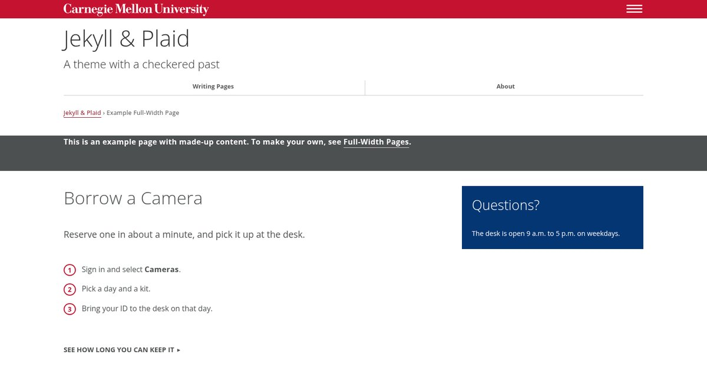

# Jekyll & Plaid

Jekyll & Plaid is a GitHub Pages theme in Carnegie Mellon style: Markdown
docs and full-width pages built from Carnegie Mellon's web template and the
[Carnegie Mellon Web Kilt](https://webkilt.andrew.cmu.edu/).

Docs: https://themes.andrew.cmu.edu/jekyll-and-plaid/

[](https://themes.andrew.cmu.edu/jekyll-and-plaid/)

## Install

In your repository's `_config.yml`:

```yaml
remote_theme: cmu-web/cmu-web-jekyll-and-plaid
title: Your Office or Project
description: A line under the name
```

Turn on GitHub Pages for the repository, and each Markdown file becomes a
page in CMU's template. The docs cover writing pages, full-width layouts and
the settings. For a site you build yourself with Jekyll 4, use
[the gem](packages/jekyll/README.md); [Deployment](DEPLOYMENT.md) has both
ways in.
